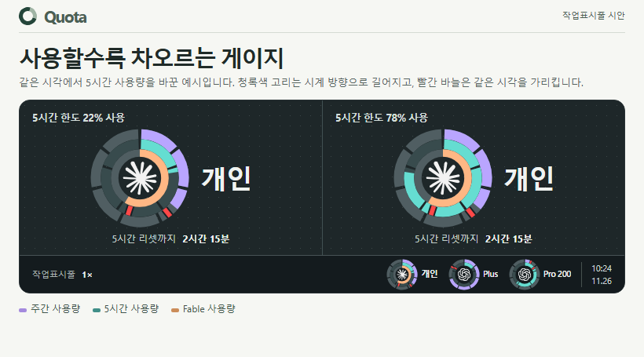

# Quota

Windows 11 x64 작업표시줄에서 Claude Code와 Codex의 계정별 구독 할당량을 확인하는 앱입니다. 계정 별칭 왼쪽의 40 DIP 게이지에는 고리가 서로 맞닿아 있고, 각 고리는 사용한 만큼 12시에서 시계 방향으로 차오릅니다. 바깥의 보라색 7칸은 주간 사용량, 청록색 5칸은 5시간 사용량입니다. Claude가 Fable 한도를 제공하면 안쪽 살구색 고리에 해당 사용량을 표시합니다.

## 게이지 읽기


빨간 바늘은 한도 주기가 시작되면 12시에서 출발해 시계 방향으로 움직입니다. 바깥 바늘은 하루에 한 칸, 안쪽 바늘은 한 시간에 한 칸을 지납니다. 바늘에서 12시까지 시계 방향으로 남은 눈금이 다음 리셋까지 남은 시간입니다. 리셋 시각을 지나면 다음 조회까지 12시에 끊어진 빨간 선이 표시됩니다. 공급자가 리셋 시각을 제공한 고리에만 바늘이 나타납니다. 계정을 누르면 상세 패널의 막대와 숫자에서 같은 사용률을 확인하고, 그 아래에서 초기화까지 남은 시간과 현지 시각을 볼 수 있습니다.



저장소를 내려받아 [시안](index.html)을 열면 40 DIP 게이지와 오른쪽 별칭을 실제 크기로 볼 수 있습니다. **고리 위 시곗바늘**에서 **+1시간**을 누르면 5시간 바늘이 시계 방향으로 한 칸 전진합니다. **별칭 아래 시간 눈금**으로 전환해 비교할 수 있습니다. **사용량 바꿔 보기**에서 슬라이더를 올리면 고리가 12시부터 시계 방향으로 차오릅니다. 0%에서는 비어 있고 100%에서는 한 바퀴가 모두 채워집니다. 이 화면은 예시 데이터를 사용합니다.

## 설치와 계정 연결

1. `dist/Quota-1.1.1-windows-x64-setup.exe`를 실행합니다. 설치는 현재 Windows 사용자에게 적용됩니다. WebView2가 없는 PC는 최초 설치 시 인터넷 연결이 필요합니다. 이 빌드는 미서명입니다.
2. 시작 메뉴에서 **Quota**를 열고 Claude 또는 GPT를 선택합니다. 제안된 폴더를 확인하거나 **폴더 선택**으로 Windows에서 이미 로그인한 CLI 프로필을 지정합니다. Claude는 `.credentials.json`, Codex는 구독 OAuth 로그인이 들어 있는 `auth.json`을 사용하는 프로필을 지원합니다.
3. **이 폴더로 연결**을 누릅니다. 폴더를 한 계정 전용으로 사용해 왔다면 전용 폴더 확인란을 선택할 수 있습니다. 확인하지 않으면 계정 ID가 없는 과거 기록은 집계에서 제외됩니다.
   두 번째 GPT를 추가할 때는 **계정 설정 → 계정 추가 → GPT · Codex**에서 별칭을 입력하고 **GPT 로그인 링크 받기 → 로그인 링크 복사**를 누릅니다. 이 PC에서 추가할 계정이 로그인된 브라우저 프로필을 열고 주소창에 링크를 붙여넣으세요. 인증이 끝나면 앱이 해당 계정을 연결합니다. 기다리는 중에 **로그인 취소**를 누르면 링크를 폐기하고 다시 시작할 수 있습니다. Claude도 같은 방법으로 추가할 수 있습니다. 해당 CLI가 이 PC에 설치되어 있어야 합니다.
   앱은 로그인할 때마다 `%LOCALAPPDATA%\TaskbarAiQuota\profiles` 아래에 새 폴더를 만들고 해당 CLI의 로그인 프로세스에만 그 경로를 지정합니다. 새 계정의 로컬 사용 이력을 쌓으려면 Codex 또는 Claude Code를 사용할 때도 계정 카드에 표시된 폴더를 각각 `CODEX_HOME` 또는 `CLAUDE_CONFIG_DIR`로 지정하세요.
4. **계정 설정**에서 표시 여부와 순서를 정합니다. 게이지를 누르면 계정 상세가 열립니다. 표시 공간이 부족할 때는 `+N` 또는 알림 영역의 Quota 아이콘을 사용합니다. 창을 닫으면 작업표시줄에서 계속 실행되고 **종료**를 누르면 앱이 끝납니다.

## 데이터와 조회

- 등록한 프로필의 자격 정보로 각 서비스에 직접 요청합니다. 로그인 토큰의 갱신은 해당 CLI가 담당합니다. 앱은 CLI 인증 파일을 수정하지 않습니다.
- 한도 조회의 기본 간격은 5분입니다. 오류가 발생하면 마지막 성공 시각과 상태를 확인할 수 있습니다. 폴더의 로그인 계정이 바뀌면 조회를 잠급니다. 원래 계정으로 로그인한 뒤 **원래 계정 다시 확인**을 누르면 같은 계정의 기존 이력이 유지됩니다. 혼용된 폴더의 미귀속 기록 가져오기는 중지됩니다.
- 사용 이력은 로컬 JSONL 로그의 일별 토큰 집계입니다. 막대에서 날짜를 선택하면 당일 기록을 확인할 수 있습니다. 비용을 계산할 수 없는 날은 **비용 미상**으로 표시합니다. Codex 리셋권은 수량과 만료 시각을 조회합니다.
- 앱 데이터는 `%LOCALAPPDATA%\TaskbarAiQuota`에 보관합니다. **연결 해제**는 앱에 등록된 해당 계정과 그 캐시를 삭제합니다. 업데이트와 프로그램 제거 시 계정 설정 및 캐시는 보존됩니다. 원본 CLI 프로필의 파일은 해당 CLI에서 관리합니다.

## 빌드와 검증

Windows x64, Rust MSVC 도구 체인, Visual Studio C++ Build Tools와 Windows SDK가 필요합니다. 검증 환경은 Rust 1.99.0입니다.

```powershell
cargo test --locked
powershell -NoProfile -ExecutionPolicy Bypass -File .\packaging\build.ps1
Get-FileHash .\dist\Quota-1.1.1-windows-x64-setup.exe -Algorithm SHA256
```

빌드 스크립트는 잠금 파일로 Rust 릴리스를 빌드하고, 해시로 검증한 NSIS와 Microsoft 서명을 확인한 WebView2 부트스트래퍼로 `dist`의 설치본과 체크섬 파일을 생성합니다. 최초 빌드에는 네트워크 연결이 필요합니다.

계정 조회·사용 이력의 참고 구현은 [TaskbarQuota의 고정 커밋](https://github.com/zioder/TaskbarQuota/tree/a84432b6933ff807198190101d8656c20bb34e3a)이며, 관련 라이선스는 [원본 라이선스](packaging/TaskbarQuota-LICENSE.txt)와 [아이콘 라이선스](ICONS-LICENSE.txt)에 있습니다.

